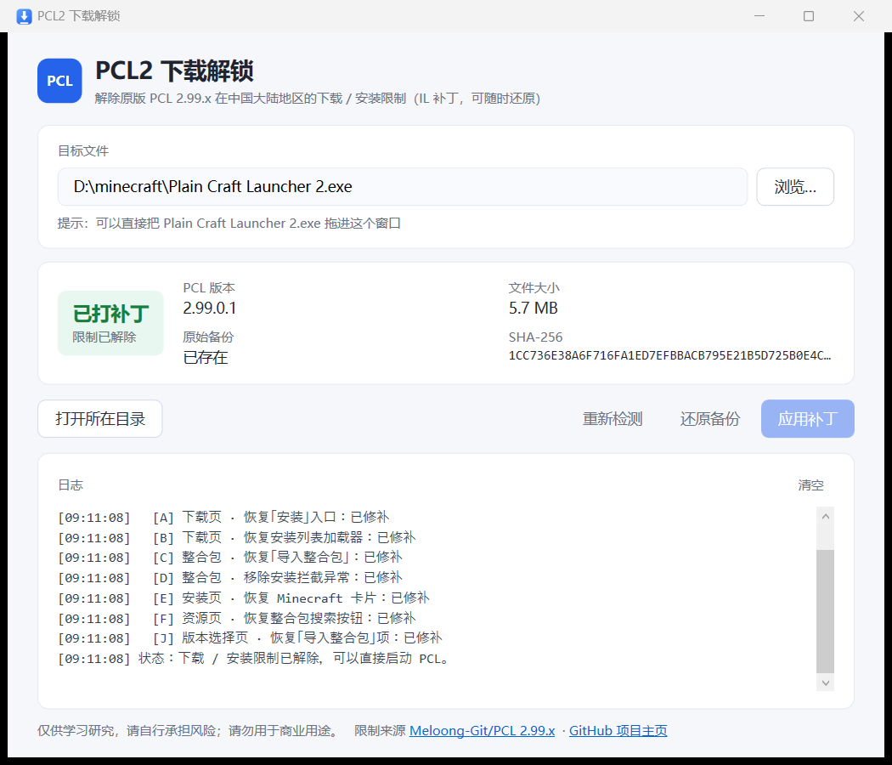

# PCL2 下载解锁

给 **原版 PCL**（[Meloong-Git/PCL](https://github.com/Meloong-Git/PCL) 2.99.x）恢复「在中国大陆地区下载 / 安装 Minecraft」的能力。

带图形界面，一键打补丁，自动备份，可随时还原。只改方法体（IL），不改功能逻辑、不加壳、不联网。



**直接下载**：[Releases](https://github.com/ailixiyaX/PCL2Unlock/releases/latest)（Windows x64 单文件，无需安装 .NET）

## 背景

2026-10 起，原版 PCL 移除了中国大陆地区的 Minecraft 安装 / 下载入口：

- [`e4b0489`](https://github.com/Meloong-Git/PCL/commit/e4b0489a22cfd4bc57a18fc1e2ac66d5c18e7fc1)（2.99.0.0）：移除版本下载、整合包安装，多个入口改为提示；
- [`e3d1cff`](https://github.com/Meloong-Git/PCL/commit/e3d1cffed50dd2c7d57f5c0426c5b59ae92d28ce)（2.99.0.1）：继续删掉剩余的导航入口（下载页、版本选择页）。

打开这些地方的开关是 `ModSecret.RestrictMcDownload As Boolean = True`——一个**编译期常量**，IL 里已经被折叠成布尔字面量，运行时既没有字段可翻，也没有配置可关。所以本工具不去「改开关」，而是把被改写、被删掉的那几个方法体重新补回去。

## 补丁点

全部改动都在 `Plain Craft Launcher 2.exe` 内嵌的程序集 `Plain Craft Launcher 2`（2.99.0.1，无强名称）里，共 7 处：

| # | 位置 | 原版（受限） | 补丁后 |
|---|------|--------------|--------|
| A | `PCL.PageDownloadLeft::.ctor` | 构造函数尾部 16 条指令把「安装」入口设为 Collapsed、`PageID` 强制为「Mod」 | 截断隐藏块，保留「原版游戏」导航 |
| B | `PCL.PageDownloadInstall::LoaderInit` | 安装列表被换成 `LoaderTask("关闭下载", …)` 占位 | 恢复 `ModDownload.DlClientListLoader` 真实加载器 |
| C | `PCL.ModModpack::ModpackInstall()` | 开头 `Hint(…); Return` | 改为后台线程调用新增的 `PclfixImportModpack`，真正执行导入 |
| D | `PCL.ModModpack::ModpackInstall(String,String,String)` | 尾部 `Throw New Exception("…不再提供 MC 下载…")` | 改为 `leave` + `ldnull; ret`（正常返回，调用方均 `pop`） |
| E | `PCL.PageDownloadModify::LoadInstanceFinished` | Minecraft 卡片 `Visibility = Collapsed` | 改为 `Visible` |
| F | `PCL.PageResource::set_PageType` | 整合包搜索按钮被固定 `Collapsed` | 插入条件：仅当页签不是整合包时隐藏 |
| J | `PCL.PageSelectLeft::McFolderListUI` | 「导入整合包」项构造后**没有**加进列表面板 | 插入 `FrmSelectLeft.PanList.Children.Add(ItemInstall)` |

> 这些补丁点都带「已修补 / 未修补 / 不适用」三态判定，可以重复运行；判定依据是改写后的指令序列，不是文件哈希，所以同一版本的不同构建也能识别。

## 使用

### 图形界面

1. 把 `PCL2Unlock.exe` 放到 `Plain Craft Launcher 2.exe` 旁边（放一起就会自动识别）；
2. 双击打开，确认徽章是「未打补丁」；
3. 关闭正在运行的 PCL；
4. 点「应用补丁」→ 看到「已打补丁」；
5. 启动 PCL，进入「下载」页，左侧应该出现「原版游戏」。

原始文件会自动备份为 `Plain Craft Launcher 2.exe.pcl2fix.bak`，随时可以点「还原备份」恢复。

### 命令行

```bat
PCL2Unlock.exe                 :: 自动探测 + 打补丁
PCL2Unlock.exe --check         :: 只检测
PCL2Unlock.exe --revert        :: 从备份还原
PCL2Unlock.exe --help          :: 帮助
PCL2Unlock.exe D:\path\Plain Craft Launcher 2.exe
```

退出码：`0` 成功 / `1` 失败 / `2` 用法错误 / `3` 不是 PCL / `4` 无可用补丁点 / `5` 校验失败 / `6` 文件被占用。

## 已验证

- 2.99.0.1（6,019,072 字节，SHA-256 `2749AA5D…9DBA453`）→ 7 处全部命中，补丁后固定为 `1CC736E3…FA92DC`（确定性，可复现）；
- 补丁后启动正常，下载页出现「原版游戏 / 最新版本 26.3 / 26.4-snapshot-6」；
- 实际点「开始下载」成功下载 26.3 并完成安装：`26.3.jar：已完成` → `下载原版支持库文件 Finished` → `版本合并 26.3 完成` → `记录安装清单`，日志中无任何 `ERR!` / `FTL!`；
- `--revert` 后 SHA-256 回到原值，字节级一致。

## 构建

需要 .NET SDK 8+：

```bat
dotnet publish src/PCL2Unlock/PCL2Unlock.csproj -c Release -r win-x64 --self-contained true -p:PublishSingleFile=true -o out
```

产物是单文件自包含 exe（约 64 MB），目标机器无需安装 .NET。

## 注意

- 只支持 **2.99.x**（有 `PageDownloadLeft` / `PageDownloadInstall.LoaderInit` 这些结构的版本）。更老的 2.x 本来就没有限制，不需要补丁；
- PCL 升级后程序会被覆盖，补丁需要重打（工具会识别新文件为「未打补丁」）；
- 补丁只影响「能不能下载 / 安装」，不改下载源、不改网络行为；中国大陆访问 Mojang / Fabric / NeoForge 的连通性仍取决于你的网络；
- 仅供学习研究，请自行承担风险，请勿用于商业用途。

## 许可

MIT，见 [LICENSE](LICENSE)。
